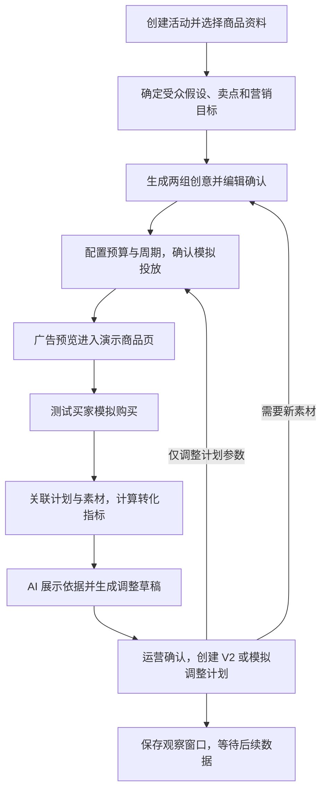

# 浙衍 AI：营销获客与广告投流 Demo 规划 V1

状态：2026-11-09 已完成首版本机业务 Demo。本文保留设计基线；实际运行、已实现范围和限制以 README.md、docs/验收记录.md 为准。经用户确认，首版 AI 使用明确标注的演示回放并预留模型接口，尚未接入真实模型；投放与支付模拟。

## 1. 产品定位与第一版目标

面向电商商家和运营人员，围绕同一个营销活动，把商品资料、营销创意、广告计划、转化结果和优化动作关联起来。

第一版目标：演示运营人员如何把一个商品变成两组营销创意，创建模拟投放计划，切换到消费者视角完成模拟购买，再根据有来源的数据创建下一版素材或调整草稿。

角色：一个演示运营账号；消费者视角使用虚构测试买家。老板通过工作台和结果页查看整体情况。

固定业务场景：一个演示店铺、一个商品、商品推广、两组创意。直播推广列为后续扩展。

首版推广目标固定为“商品成交”；新客数作为获客结果分析项。是否能把新客设置为真实平台的优化目标，需要后续按具体投放产品核实。

虚构案例：青禾生活旗舰店推广随行保温杯，演示售价 99 元，容量 500 ml，奶油白。上述内容均为测试设定，不代表真实商家。未提供依据的保温时长、检测结果、销量和用户评价不作为可用宣传事实。

营销获客与投流的关系：营销方案明确商品、受众假设和购买理由；广告计划负责付费触达的配置与执行管理；商品承接和支付结果体现转化。只有具备可核验历史记录时，才能进一步识别新客。

## 2. 页面与基础功能

第一版共 6 个后台页面、1 个消费者演示页面。设置项和执行记录采用抽屉或页内区域，不额外建设复杂管理后台。

| 编号 | 页面/模块 | 必做基础功能 | 主要输出 | 验收重点 |
|---|---|---|---|---|
| M1 | 工作台与营销活动 | 活动列表、新建/继续活动、当前步骤、待处理事项、活动结果摘要 | 活动记录及其进度 | 刷新后可打开同一活动继续操作 |
| M2 | 商品与品牌资料 | 商品名称、价格、规格、卖点、品牌颜色、图片/已有视频上传、宣传限制、资料来源 | 商品资料及版本 | 编辑价格或规格后，后续生成引用正确版本 |
| M3 | 营销与创意工作台 | 受众假设、营销目标；生成两组创意方向；编辑标题、正文、行动文案和视频脚本；模板海报/封面预览与导出；素材确认 | 营销方案、创意版本、确认记录 | 能单独重生成一版，保留另一版及人工编辑 |
| M4 | 广告投放中心 | 选择演示账户、商品和确认素材；预算、周期、目标；参数预览与人工确认；模拟启动/暂停/结束；执行结果 | 计划快照、状态与操作日志 | 每个计划使用指定素材版本，修改产生记录 |
| M5 | 效果与获客 | 按活动/计划/素材看数据；演示曝光、点击、消耗、成交；订单及买家列表；新老客/未知状态；数据来源和时间范围 | 指标、演示转化记录、对应来源 | 指标由程序计算，能从汇总查到依据 |
| M6 | AI 优化与复盘 | 基于选定数据集分析；区分事实/假设/缺失信息；生成素材或计划调整草稿；确认后模拟执行；保存观察窗口 | 建议、V2 草稿、变更记录 | 采纳建议有具体输出，后续结果不足时保持待观察 |
| C1 | 消费者演示页 | 广告预览、演示商品详情、选择虚构买家、模拟下单、结果页 | 本次互动事件和模拟订单 | 可从本次订单反查活动、计划、素材版本 |

支撑功能：本地持久化、文件保存、任务状态、重复请求处理、失败重试、演示数据加载、模型调用配置。演示数据重置只影响明确选中的测试数据集，需先说明清理范围。

M3 的视频能力限定为脚本生成和已有视频上传/预览；完整视频生成、专业剪辑和数字人不作为第一版交付依赖。

C1 是本地演示商品承接体验，不是抖音正式商品页，也不表示真实抖音广告能够直接跳转到它。

## 3. 完整业务链路

图中的消费者页面访问和点击是本系统可记录的测试事件；渠道曝光、广告消耗、广告执行和支付成功均为演示数据或模拟动作。

| 步骤 | 操作 | 系统产物 | 需要满足的条件 |
|---|---|---|---|
| 1 | 选择商品，创建新品推广活动 | 活动编号、商品资料快照 | 商品事实和图片齐全 |
| 2 | 描述目标客群和推广目标 | 两个待验证的创意方向 | AI 生成的客群建议标为营销假设 |
| 3 | 生成文案/脚本，选择模板，人工编辑 | 两组素材及各自版本 | 不把未提供的商品性能写成已证实卖点 |
| 4 | 确认素材，配置演示计划 | 预算、周期、推广目标、素材快照 | 只使用已确认版本；账户标为演示账户 |
| 5 | 确认并模拟执行 | 模拟计划状态和执行记录 | 双击不会重复建立同一任务 |
| 6 | 打开广告预览，进入商品页并模拟购买 | 本次互动记录、模拟订单 | 测试会话显式关联一个计划和素材版本 |
| 7 | 查看本次互动，或切换查看历史演示数据 | 对应范围的指标与转化列表 | 两类数据分开，不把历史曝光与现场订单混算 |
| 8 | 请求 AI 复盘，查看事实与建议 | 有来源的分析、可执行的调整草稿 | 数字由程序提供，模型不自行生成效果数据 |
| 9 | 采纳建议，创建 V2 或确认计划变更 | 版本差异、操作记录、下一观察窗口 | 不自动覆盖 V1，不自动生成改善后的结果 |

营销主要体现于步骤 1—3；广告投流主要体现于步骤 4—5；转化和获客主要体现于步骤 6—7；步骤 8—9 将结果反馈到下一轮经营动作。

## 4. 计划突出展示的四个特点

这些是本项目要重点实现、验证的体验，不宣称行业首创，也不代表竞品均未提供。

### 特点 A：营销内容受商品事实约束

保存价格、规格、卖点依据和宣传限制。生成的内容附带使用的资料版本，检查已知字段冲突和指定禁止表达。

演示动作：故意将售价改错或加入没有依据的性能承诺，系统提示核对；运营修改后才能确认该版本。规则检查不等同于完整广告合规审核，也不承诺发现所有问题。

价值：减少商品资料、广告表达和商品详情之间的不一致。

### 特点 B：营销方案、素材、投放与转化能相互追溯

每个创意属于一个活动，每个计划绑定明确的素材快照，每条演示转化保留来源信息。

演示动作：点击一条订单，查到所属计划、素材版本和创意方向；回到活动，查看不同创意的表现。

价值：让运营能够判断哪些内容值得继续测试。归因关系仅表示所选统计规则下的关联，不证明广告的因果增量。

### 特点 C：AI 建议可以生成具体工作草稿

建议显示统计范围、数据事实、待验证原因、缺失信息和下一步动作。支持“生成 V2 素材草稿”或“生成计划调整草稿”。计划草稿展示影响对象、修改前后值、确认人和执行结果。

演示动作：从一条表现异常的计划进入诊断，采纳一个素材建议，生成保留原商品资料和活动关系的 V2。

价值：减少从读报告到实际开展工作的跳转。AI 不独立执行真实花费动作；数据不足时说明无法判断。

### 特点 D：可切换消费者视角验证转化

后台计划可以打开对应演示广告和商品页，使用已知的虚构新买家/老买家完成模拟下单，随后在后台查看结果。

演示动作：分别使用两类测试买家下单，查看相同订单数下新客数如何不同。

价值：让“获客”成为可演示的数据过程；不把曝光、点击和订单直接当作新客户。

## 5. 数据范围、指标与演示数据

### 数据来源必须显式区分

1. 历史演示数据：固定的虚构报表、订单和买家历史，供对比与 AI 复盘使用。加载后持久化，刷新不重新随机生成。
2. 本次互动：本地演示页记录的访问、点击与模拟订单。单独展示；没有匹配的曝光/消耗数据时，不计算 CTR、投产比或获客成本。
3. 可选扩展：真实授权报表或用户提供的 CSV。需要字段映射与统计口径确认，不作为第一版必要条件。

每份数据绑定数据集编号、活动/计划、时间范围、来源类型和统计口径。前后阶段对比时显示各自窗口，不混用不同来源的数值。

### 演示关联规则

- 本次测试会话显式绑定一个计划及其素材版本；模拟订单沿用该来源。
- 测试买家只使用虚构标识，不要求真实手机号或支付信息。
- 已知历史中有本店成功支付记录的标为老客；完整测试历史中没有既往支付且本次首次成功的标为新客。
- 缺少历史信息时标为“新老客未知”，不能因为缺数据就判为新客。
- 同一买家多次下单时，订单可增加，买家数和新客人数按规则去重。
- 页面刷新不重复创建订单；重复提交返回已有操作结果。
- 将来接入真实平台时，按可用授权数据和平台口径重新映射；本地演示规则不能当成抖音真实归因规则。

### 简化指标口径

| 指标 | Demo 计算方式 | 限制 |
|---|---|---|
| 点击率 | 演示广告点击量 ÷ 演示广告曝光量 | 同一数据集和时间范围 |
| 支付订单数 | 支付成功状态的模拟订单数 | 不等于支付买家数 |
| 支付买家数 | 对应模拟订单的买家去重数 | 不等于新客数 |
| 新客数 | 符合本店首次购买测试规则的买家去重数 | 依赖完整演示历史；缺失时未知 |
| 订单广告成本 | 对应范围广告消耗 ÷ 支付订单数 | 分母为零时显示不可计算 |
| 演示支付 ROI | 对应范围模拟支付金额 ÷ 广告消耗 | 本版数据不含退款、补贴、预售；不是利润率 |
| 广告花费口径的新客成本 | 对应范围广告消耗 ÷ 新客数 | 需对应买家历史完整；不包含全部营销成本，不代表全公司 CAC |

所有指标由程序计算；AI 只读取校验后的结果。缺失值显示“未知/暂无数据”，不能自动填 0。

如果买家中存在新老客未知的情况，应展示识别覆盖情况，新客成本标为暂不可评估，避免用不完整的新客人数计算总体获客成本。

### 固定样例 D0

以下数字纯属测试设定，每个买家只有一笔对应支付订单，两个计划的买家不重复。用途是核验计算和展示不同表现，不证明真实策略有效。

| 计划 | 创意方向 | 曝光 | 点击 | 消耗 | 支付订单/买家 | 新客 | 支付金额 |
|---|---|---:|---:|---:|---:|---:|---:|
| A | 通勤携带 | 4,000 | 120 | 120 元 | 9 | 5 | 891 元 |
| B | 容量展示 | 6,000 | 180 | 180 元 | 6 | 4 | 594 元 |
| 合计 | — | 10,000 | 300 | 300 元 | 15 | 9 | 1,485 元 |

合计验算：点击率 3%；订单广告成本 20 元；演示支付 ROI 4.95；广告花费口径的新客成本约 33.33 元。各计划 ROI 先按原始金额计算，汇总时使用总金额/总消耗，不平均两个比值。

两组创意并不是随机对照实验。AI 可指出样例中的差异并提出待验证假设，不应声称已经证明哪种创意导致更好效果。V2 初始结果为空，状态为待观察。

## 6. 真实实现、模拟部分与后续范围

| 范围 | 第一版处理方式 |
|---|---|
| 活动、商品、资料、素材版本、确认记录 | 真实保存并可再次打开 |
| AI 文案、脚本、复盘建议 | 接一个可用文本模型实际生成；保留人工编辑 |
| 海报/封面 | 基于上传图片和固定模板实际渲染与导出 |
| 演示页访问和点击 | 真实记录发生在本 Demo 内的测试行为 |
| 广告账户、曝光、消耗、投放执行、支付 | 明确标为演示或模拟，无真实广告花费和资金流 |
| 模型失败或演示环境离线 | 保留已有结果并支持重试；预存内容标为“演示回放” |
| 真实广告平台接入 | 后续凭授权验证可用账户、报表和写入能力，不能从演示执行推断已接通 |

第一版暂缓：真实直播投流、多平台投放、完整达人建联与寄样、GEO 效果优化、企业官网/客服套件、完整 CRM、自动加预算、大规模视频生成、复杂多租户与收费体系。

## 7. 最小业务关联与状态

业务关联：活动 → 商品资料快照 → 创意方案与素材版本 → 计划 → 演示事件/订单 → 分析结果 → 调整记录。

| 对象 | 必要状态或规则 |
|---|---|
| 素材 | 草稿 → 已确认；修改后创建新版本重新确认 |
| 计划 | 草稿 → 待确认 → 模拟运行中 → 暂停/结束；失败保留原因 |
| 生成任务 | 排队/处理中/成功/失败；可重试失败步骤 |
| 优化建议 | 待处理 → 已采纳/暂不采纳；采纳生成草稿而非直接花费 |
| 调整记录 | 待确认 → 模拟执行 → 观察中 → 已复盘；没有数据时不填成功收益 |

AI 与执行职责分开：AI 生成结构化内容或建议；业务服务校验商品事实、计算指标、管理状态并执行获准的模拟动作。第一版不以多个独立 Agent 为必需架构。

## 8. 单人开发顺序与验收

| 阶段 | 工作内容 | 阶段完成标准 |
|---|---|---|
| 1 | 固定案例、页面结构、字段和演示数据 | 从活动到结果能用示例内容点击走通 |
| 2 | 保存商品/活动/素材版本，接通计划状态 | 关闭或刷新页面后可继续，不覆盖确认版本 |
| 3 | 完成演示商品页、模拟下单和指标计算 | 一条新订单能正确改变本次互动统计，并能追溯来源 |
| 4 | 接入文本模型、模板出图和建议草稿 | 能真实生成、编辑、导出；建议可以创建 V2 |
| 5 | 串联演示、失败处理、数据范围校验 | 主流程及关键异常流程可重复演示 |

时间需结合实际技术栈、模型可用性和界面要求估算，以上按可交付结果安排，不承诺未经验证的开发天数。

验收清单：

- 能从创建活动一路操作到产生 V2 草稿并进入待观察状态。
- 能现场修改文案，导出与预览一致的模板素材。
- 已确认素材被计划引用后，后续编辑不会改变历史快照。
- 双击生成/模拟下单不产生重复任务或重复订单。
- 测试新客、老客和未知历史三种情况，显示符合规则。
- 历史演示数据与现场互动数据分开，计算结果可复核。
- 分母为零、缺少成交数据时，不输出虚假的 0 成本或优化成功结论。
- 模型超时保留原内容，重试或回放均明确标注。
- 模拟执行、演示数据、预存回放在页面和报告中标识一致。

## 9. 给老板的演示脚本

1. 在工作台说明本轮商品、营销目标和演示范围。
2. 打开两组创意，现场修改一句文案，确认一版素材。
3. 创建并确认模拟投放方案，展示预算、素材版本和计划状态。
4. 切换消费者视角，完成一次模拟购买。
5. 返回后台找到该订单，展示计划来源及新老客识别。
6. 切换到固定历史演示数据，展示数据对比与计算依据。
7. AI 提出待验证的优化方向，采纳后创建 V2 草稿。
8. 展示版本差异和待观察状态，说明下一轮如何收集结果。

要验证的产品价值：运营人员可以沿一个活动查清推广了什么、用了哪些素材、执行了什么计划、获得哪些转化，以及下一步准备调整什么。Demo 不证明真实获客成本下降或 ROI 提升。

## 10. 参考依据与借鉴范围

- 用户提供的 ProBoost 后台截图与 [ProBoost 官方介绍](https://proboost.microdata-inc.com/)：参考任务管理、批量操作、商品与运营结果的关联；不照搬达人合作全套流程。
- [讯灵官方介绍](https://home.xunlingai.com/)及[知识库设置文档](https://help.xunlingai.com/article.php?id=90)：参考资料复用、内容生成与知识权限的思路；不承诺 GEO 推荐效果。
- [巨量引擎营销产品](https://www.oceanengine.com/products/)：明确商品推广和直播推广是不同场景；首版选择商品推广。
- [千川官方工具说明](https://open.oceanengine.com/mcp?app_id=1837698859935771)：真实数据访问依赖授权账户及相应能力；该说明不能当成所有投放写操作都已开放的证明。

本文属于产品设计与开发规划，没有复用竞品代码，也没有执行真实广告操作。

## 11. 已选择的视觉参考与拟实现方式

用户于 2026-11-09 指定参考截图中的 Finlytic AI Agent 风格。对应公开条目为 [MotionSites：Finlytic AI Agent](https://motionsites.org/prompts/finlytic-hero)。页面将其定义为 SaaS 首屏结构化提示词，公开说明包含深色、玻璃质感、紫色强调色和背景视频；完整提示词显示需要解锁。本次仅查阅公开介绍与用户提供的截图，没有取得或复用付费提示词、原始素材及完整项目源码。

视觉方向：黑紫色科技感、紫色发光球体、克制的玻璃面板、清晰的大标题及深色工作台。球体与星空用于品牌展示区域；密集操作区域采用稳定、易读的背景。该风格选择不改变既定的营销获客与广告投流业务范围。

| 使用区域 | 拟采用的处理 | 设计目的 |
|---|---|---|
| 演示入口或工作台欢迎区 | 深黑紫背景、紫色球体主视觉、品牌标题、进入演示按钮 | 建立第一眼的产品识别；不额外扩展成完整企业官网 |
| 六个运营后台页面 | 相同黑紫配色、细边框卡片、紫色主操作与选中状态；装饰不覆盖表格 | 保持风格统一并支持持续操作 |
| 创意工作台 | 紫色选中边框、清晰区分生成中/草稿/已确认；素材内容保持自身配色 | 让界面风格与广告素材内容相互独立 |
| 效果与 AI 优化 | 深色数据面板、对比清晰的数字；成功/警告/错误使用语义颜色及文字 | 避免把涨跌、错误和品牌强调都混成紫色 |
| 消费者演示页 | 保留商品图片、价格、规格和购买按钮的清晰层级 | 验证消费者的浏览与购买路径 |

建议起始色值（本项目拟定，非对原截图的精确取色）：页面背景 `#09070F`、卡片背景 `#141020`、主操作紫 `#8B5CF6`、浅紫光效 `#C4B5FD`、主要文字 `#F5F3FF`。实现时再检查文字对比度、状态区分和实际显示效果。

动效原则：球体背景若采用视频或图像，需具备合法可用素材并提供静态回退；第一版不以复杂实时三维场景为交付前提。后台动效主要用于按钮反馈、抽屉切换、素材版本变化和任务状态提示，支持减少动画偏好。中文正文和表格采用清晰的无衬线字体。

motion-site-tools 的用途是辅助检索参考、统一设计参数和检查交互代码。其上游提供 cinematic 与 product-ui 等风格，并支持根据参考图片定制配置；这里的展示区与后台分别需要适配，不能把默认配置视为截图模板本身。依据：[上游设计配置说明](https://github.com/olbboy/motion-site-builder/blob/main/skills/motion-site-builder/references/design-profiles.md)。本轮没有可调用的 motion_* 工具，尚未执行 MCP 调用或生成界面。
